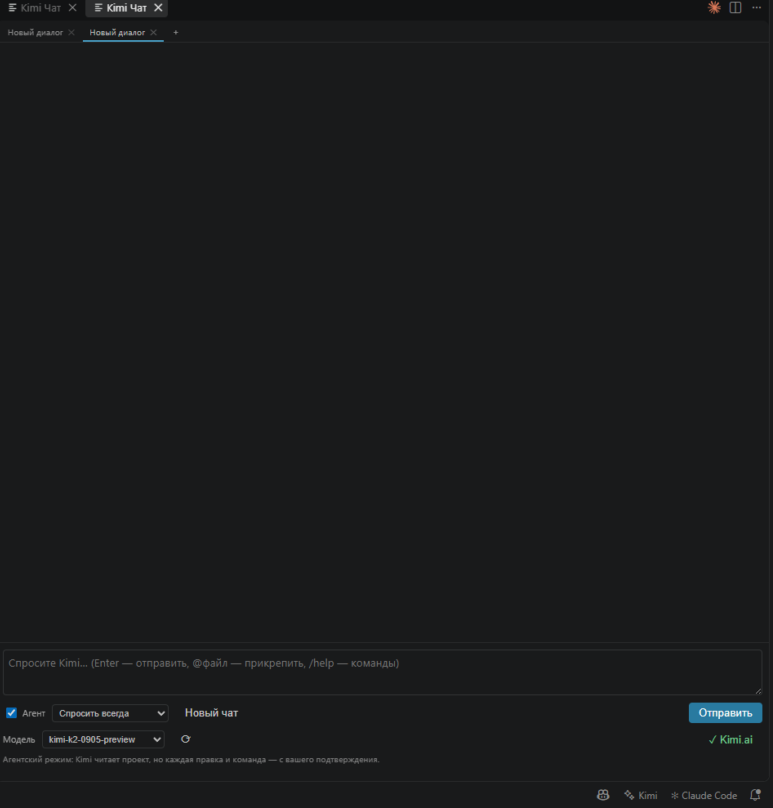
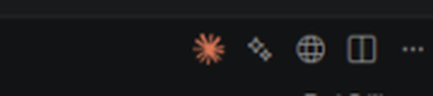
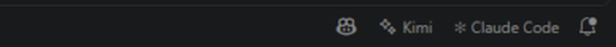

# Kimi Code — AI Assistant for VS Code

**🇷🇺 [Читать на русском](README.md)** (основная версия)

[](https://github.com/fo011y/kimi-code-vscode/releases/latest)
[](https://github.com/fo011y/kimi-code-vscode/releases)
[](LICENSE)
[](https://github.com/fo011y/kimi-code-vscode)

A VS Code extension that embeds [Kimi](https://platform.moonshot.ai) (Moonshot AI) into your editor — an independent, open-source counterpart to the Claude Code extension. Not affiliated with Moonshot AI or Anthropic.

> 🌙 **This extension was built using Kimi** — from architecture and code to documentation: AI helping to build an AI tool.

## 📥 Download & Install

**➡️ [Download kimi-code-0.7.0.vsix (latest release)](https://github.com/fo011y/kimi-code-vscode/releases/latest/download/kimi-code-0.7.0.vsix)**

Then install:

```bash
code --install-extension kimi-code-0.7.0.vsix
```

Or in VS Code: `Ctrl+Shift+P` → **Extensions: Install from VSIX…** → pick the downloaded file.

## 📸 Screenshots

Kimi chat in an editor tab — model picker, autonomy mode, account button (`✓ Kimi.ai` = signed in via website):



The ✨ button in the editor title bar — top right, next to the Claude Code icon:



Kimi in the status bar — bottom right, next to Claude Code:



## Features

- **Sidebar chat panel** — streaming conversation with Kimi. The selected code is automatically attached as context.
- **Code actions** — from the editor context menu (select code → right click):
  - `Kimi: Explain Selection`, `Kimi: Fix Selection`, `Kimi: Refactor Selection`, `Kimi: Generate Tests`
- **Edit by instruction** — `Kimi: Edit Selection by Instruction`: describe the change, review the diff, confirm.
- **Agent mode** — the "Agent" checkbox (on by default) gives Kimi tools:
  - `read_file`, `list_files`, `search_in_files` — project exploration (respects `.gitignore`);
  - `write_file` — create/modify files with diff preview;
  - `run_command` — shell commands;
  - `get_diagnostics` — linter/compiler problems from the VS Code Problems panel.
- **Permission modes** — dropdown in chat or `Kimi: Select Permission Mode`:
  - **Plan** — read-only: Kimi explores the project and produces a step-by-step plan;
  - **Ask** — every file edit and command requires confirmation;
  - **Auto-edit** — files change silently, commands need confirmation;
  - **Full auto** — ⚠️ no confirmations at all.
- **Checkpoints / Review & revert** — a snapshot is taken before the first edit of every file in a session. After an agent task, an "Changes by Kimi" panel appears in chat: click a file for a diff, accept/reject per file or all at once. Also available via `Kimi: Review Session Changes` or `/review`.
- **Multi-sessions** — conversation tabs above the chat: new (＋), switch, rename (double-click), delete (✕). Sessions persist per project.
- **Chat in editor tab** — `Kimi: Open Chat in Editor` mirrors the sidebar chat into a full editor panel.
- **@-mentions** — type `@src/app.ts` in a message to attach a file (up to 4). `Ctrl+Alt+K` inserts a reference to the selected file.
- **IDE diagnostics** — errors/warnings of the active file are auto-attached to your question.
- **Slash commands** — `/clear`, `/compact`, `/review`, `/plan`, `/ask`, `/auto`, `/fullauto`, `/help`.
- **Session history** — conversations survive VS Code restarts (per project).
- **Token counter** — per-request and per-session usage under the input box.
- **GitHub push** — `git_push` agent tool and `kimi.autoPush` setting: automatic commit + push after agent tasks.
- **Project deploy** — `deploy` agent tool and `kimi.autoDeploy` setting with `kimi.deployCommand` (any command: `npm run deploy`, `vercel --prod`, `netlify deploy --prod`…).
- **Model picker** — dropdown in chat (live list from `GET /models`, ⟳ refreshes) or `Kimi: Select Model`.
- **Sign in via Kimi website (OAuth)** — no API key needed: the same Device Code flow as the official Kimi Code CLI; tokens refresh automatically.
- **Editor title button** — a ✨ icon at the top right of every editor inserts `@file` (plus the selected line range) into the chat input.
- **Status bar** — a ✨ Kimi item at the bottom right shows the sign-in state and opens the account menu (chat, model, mode, sign in/out).

## Configuration

Two sign-in methods — the extension asks you to pick one on the first request.

### Option 1: Sign in via the Kimi website (OAuth, recommended)

1. `Ctrl+Shift+P` → **Kimi: Sign in via website (OAuth)**.
2. Pick your account region: **Kimi.com** or **Kimi.ai (Global)**.
3. A login page opens in your browser — confirm the code shown by VS Code.
4. Done: tokens live in VS Code SecretStorage and refresh automatically.

This uses the same Device Code OAuth flow (RFC 8628) as the official Kimi Code CLI (`kimi login`). A **Kimi Membership** subscription is required — it is billed separately from the API platform. Sign out with **Kimi: Sign out**.

### Option 2: API key

1. Get an API key: https://platform.moonshot.ai → **API Key Management**.
2. In VS Code: `Ctrl+Shift+P` → **Kimi: Set API Key**. The key is stored in VS Code SecretStorage.
3. The `kimi.baseUrl` setting only applies to this method (in OAuth mode the endpoint follows the chosen region automatically).

### Settings (`Ctrl+,` → "kimi")

| Setting | Default | Description |
|---|---|---|
| `kimi.baseUrl` | `https://api.moonshot.ai/v1` | API base URL. For China: `https://api.moonshot.cn/v1` |
| `kimi.model` | `kimi-k2-0905-preview` | Model (e.g. `kimi-latest`, `moonshot-v1-32k`) |
| `kimi.temperature` | `0.6` | Sampling temperature |
| `kimi.maxTokens` | `8192` | Max tokens per response |
| `kimi.maxAgentSteps` | `25` | Agent step limit per request |
| `kimi.permissionMode` | `ask` | Autonomy: `plan` / `ask` / `autoEdit` / `fullAuto` |
| `kimi.autoPush` | `false` | Auto commit & push to GitHub after agent tasks |
| `kimi.deployCommand` | `""` | Deploy command (shell) |
| `kimi.autoDeploy` | `false` | Auto deploy after agent tasks (after auto-push) |
| `kimi.respectGitIgnore` | `true` | Respect `.gitignore` when walking files |
| `kimi.attachSelection` | `true` | Attach selected code to messages |
| `kimi.attachOpenFile` | `false` | Attach the whole open file when nothing is selected |
| `kimi.useCtrlEnterToSend` | `false` | Send with Ctrl+Enter |
| `kimi.showMessageTimestamps` | `false` | Show message timestamps |

## Security

- The API key and OAuth tokens are stored only in VS Code SecretStorage.
- In `ask` mode every file write and command requires confirmation. `fullAuto` disables all confirmations — use only in projects you trust (preferably under git).
- Agent tools cannot leave the opened project folder.
- Command timeout: 60 seconds (deploy: 10 minutes).

## Development

```bash
npm install
npm run compile   # or: press F5 in VS Code to launch the Extension Development Host
npx vsce package  # produce the .vsix
```

## Project structure

```
src/
  api.ts         — Moonshot API client (SSE streaming, tool calling)
  config.ts      — settings and auth method selection
  auth.ts        — Kimi website sign-in (Device Code OAuth, refresh tokens)
  chatPanel.ts   — chat webview (sidebar + editor tab), sessions, review panel
  agent.ts       — agent loop (tool calling)
  tools.ts       — tools: files, search, shell, git, deploy, diagnostics
  checkpoints.ts — file snapshots, diff and revert
  extension.ts   — entry point, commands, keybindings
```

## License

[MIT](LICENSE) © fo011y
