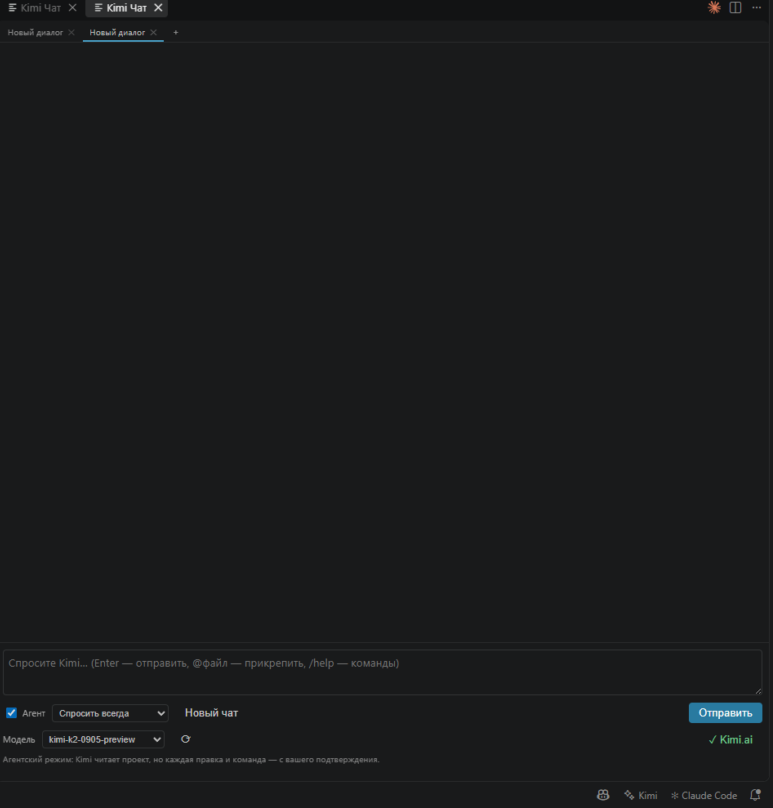
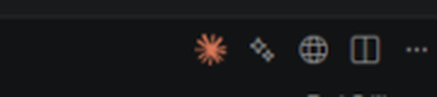
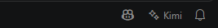
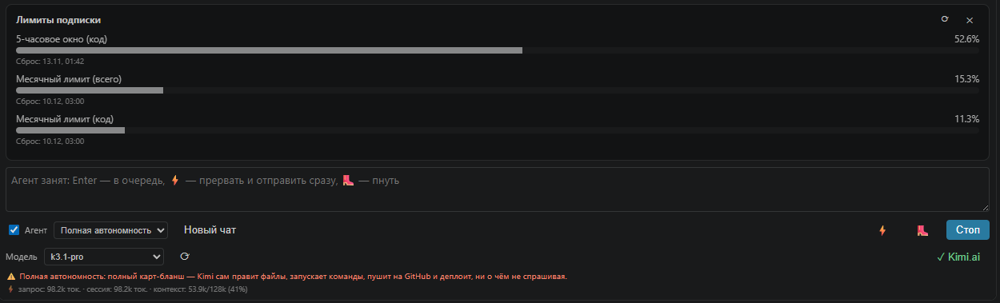

# Kimi Code — AI-ассистент для VS Code

**🇬🇧 [Read in English](README.en.md)**

[](https://github.com/fo011y/kimi-code-vscode/releases/latest)
[](https://github.com/fo011y/kimi-code-vscode/releases)
[](LICENSE)
[](https://github.com/fo011y/kimi-code-vscode)

Расширение, которое встраивает [Kimi](https://platform.moonshot.ai) (Moonshot AI) в VS Code — независимый открытый аналог расширения Claude Code. Не аффилировано с Moonshot AI и Anthropic.

> 🌙 **Это расширение создано с использованием Kimi** — от архитектуры и кода до документации: AI помогал писать AI-инструмент.

## 📥 Скачать и установить

**➡️ [Скачать kimi-code.vsix (последний релиз)](https://github.com/fo011y/kimi-code-vscode/releases/latest/download/kimi-code.vsix)**

Затем установите:

```bash
code --install-extension kimi-code.vsix
```

Или в VS Code: `Ctrl+Shift+P` → **Extensions: Install from VSIX…** → выберите скачанный файл.

## 🆕 Новое в 0.9.7

- **Английский интерфейс** — расширение стало двуязычным: язык выбирается автоматически по языку интерфейса VS Code (русский VS Code → русский, любой другой → английский). Переведены чат-панель, меню аккаунта, диалоги входа, статус-бар, карточка лимитов подписки и системные подсказки агента.
- **Постоянная ссылка скачивания** — `releases/latest/download/kimi-code.vsix` всегда ведёт на свежую версию, больше не устаревает.

История всех версий — на странице [релизов](https://github.com/fo011y/kimi-code-vscode/releases).

## 📜 История версий

| Версия | Что нового |
|---|---|
| [0.9.7](https://github.com/fo011y/kimi-code-vscode/releases/tag/v0.9.7) | Английский интерфейс — язык выбирается автоматически по языку VS Code; постоянная ссылка скачивания |
| [0.9.6](https://github.com/fo011y/kimi-code-vscode/releases/tag/v0.9.6) | Вкладка «Kimi Чат» в редакторе сама восстанавливается после перезапуска окна |
| [0.9.5](https://github.com/fo011y/kimi-code-vscode/releases/tag/v0.9.5) | Прогон переживает перезапуск окна: авторезюме задачи, сохранение частичного ответа, живая лента при переоткрытии панели |
| [0.9.4](https://github.com/fo011y/kimi-code-vscode/releases/tag/v0.9.4) | Сериализация состояния вкладки чата в редакторе |
| [0.9.3](https://github.com/fo011y/kimi-code-vscode/releases/tag/v0.9.3) | Лимиты подписки как на сайте kimi.ai — карточка с прогресс-барами и датами сброса прямо в чате |
| [0.9.2](https://github.com/fo011y/kimi-code-vscode/releases/tag/v0.9.2) | Агент не останавливается на полуслове — автоподталкивание, если ход завершён обещанием вместо действия |
| [0.9.1](https://github.com/fo011y/kimi-code-vscode/releases/tag/v0.9.1) | Авто-обновление OAuth-токена при 401 посреди работы |
| [0.9.0](https://github.com/fo011y/kimi-code-vscode/releases/tag/v0.9.0) | Чат открывается вкладкой в центре редактора — как у Claude Code; иконка вкладки, singleton-панель |
| [0.8.5](https://github.com/fo011y/kimi-code-vscode/releases/tag/v0.8.5) | Метки времени у сообщений по умолчанию; время у групп шагов агента |
| [0.8.4](https://github.com/fo011y/kimi-code-vscode/releases/tag/v0.8.4) | Комментарии агента между шагами — текст больше не сливается в стену; сворачиваемые группы инструментов |
| [0.8.3](https://github.com/fo011y/kimi-code-vscode/releases/tag/v0.8.3) | Исправлена «мёртвая» панель; самодиагностика вебвью (готовность, квитанции, повтор init) |
| [0.8.1](https://github.com/fo011y/kimi-code-vscode/releases/tag/v0.8.1) | Диагностика веб-панели в Output-канале; `img-src` в CSP для скриншотов |
| [0.8.0](https://github.com/fo011y/kimi-code-vscode/releases/tag/v0.8.0) | OAuth-вход через сайт Kimi, очередь сообщений и «молния» ⚡, кнопка «👢 Пнуть» и авто-пинок, автоархивация при лимите токенов, лимиты использования, скриншоты по Ctrl+V, мультисессии с поиском, checkpoints/откат, полная автономность |
| [0.7.0](https://github.com/fo011y/kimi-code-vscode/releases/tag/v0.7.0) | Вход через сайт Kimi (OAuth, device code flow) — без API-ключа |
| [0.6.0](https://github.com/fo011y/kimi-code-vscode/releases/tag/v0.6.0) | Панель принятия правок, мультисессии, чат во вкладке редактора, учёт .gitignore, Ctrl+Alt+F |
| [0.5.0](https://github.com/fo011y/kimi-code-vscode/releases/tag/v0.5.0) | Checkpoints/откат, режим планирования, @файлы, диагностика IDE, история сессий, счётчик токенов |

## 📸 Скриншоты

Чат Kimi во вкладке редактора — выбор модели, режим автономности, кнопка аккаунта (`✓ Kimi.ai` — вход через сайт выполнен):



Кнопка ✨ в заголовке редактора — справа вверху, рядом с иконкой Claude Code:



Kimi в статус-баре — внизу справа, рядом с Claude Code:



Лимиты подписки прямо в чате (меню аккаунта → «📊 Лимиты использования») — 5-часовое окно и месячные лимиты с датами сброса, как на сайте kimi.ai:



## Возможности

- **Двуязычный интерфейс** — русский и английский, выбирается автоматически по языку интерфейса VS Code (русский VS Code → русский чат, любой другой → английский).
- **Чат-панель в сайдбаре** — диалог с Kimi с потоковым выводом. Выделенный код автоматически прикрепляется к вопросу как контекст.
- **Действия с кодом** — из контекстного меню редактора (выделите код → правая кнопка):
  - `Kimi: Объяснить выделенное`, `Kimi: Исправить выделенное`, `Kimi: Отрефакторить выделенное`, `Kimi: Написать тесты для выделенного`
- **Правка по инструкции** — `Kimi: Изменить выделенное по инструкции`: опишите, что изменить, увидите diff и подтвердите применение.
- **Агентский режим** — галочка «Агент» (включена по умолчанию) даёт Kimi инструменты:
  - `read_file`, `list_files`, `search_in_files` — изучение проекта (с учётом `.gitignore`);
  - `write_file` — создание/изменение файлов с diff-предпросмотром;
  - `run_command` — запуск shell-команд;
  - `get_diagnostics` — ошибки и предупреждения из панели «Проблемы» VS Code.
- **Режимы автономности** — выпадающий список в чате или команда `Kimi: Выбрать режим автономности`:
  - **Планирование** — Kimi только читает проект и составляет пошаговый план;
  - **Спросить всегда** — каждая правка файла и каждая команда требуют подтверждения;
  - **Авто-правки** — файлы изменяются без вопросов, команды — с подтверждением;
  - **Полная автономность** — ⚠️ полный карт-бланш: правки, команды, автопуш на GitHub и автодеплой — всё без вопросов, даже если `kimi.autoPush`/`kimi.autoDeploy` выключены.
- **Checkpoints / откат** — перед первой правкой каждого файла за сессию сохраняется снимок. После задачи агента в чате появляется панель «Изменения Kimi»: diff по клику, принять/откатить по файлу или все сразу. Также: команда `Kimi: Изменения за сессию (откат)` или `/review`.
- **Мультисессии** — вкладки диалогов над чатом: новая (＋), переключение, переименование (двойной клик), удаление (✕). Сессии хранятся по проекту.
- **Чат во вкладке редактора** — команда `Kimi: Открыть чат в редакторе` открывает тот же чат большой панелью.
- **@-упоминания** — напишите `@src/app.ts` в сообщении, и файл прикрепится к контексту (до 4 файлов). `Ctrl+Alt+K` вставляет ссылку на выделенный файл в поле ввода.
- **Диагностика IDE** — ошибки и предупреждения активного файла автоматически прикрепляются к вопросу.
- **Слэш-команды** — `/clear`, `/compact` (сжатие истории в сводку), `/review`, `/plan`, `/ask`, `/auto`, `/fullauto`, `/help`.
- **История сессий** — диалог сохраняется между перезапусками VS Code (по проекту). При открытии чата автоматически восстанавливается последний активный диалог с историей (до 100 сообщений).
- **Поиск по истории** — кнопка 🔍 во вкладках диалогов: ищет по всем сессиям проекта, подсвечивает совпадения, клик по результату переключает диалог и прокручивает к найденному сообщению.
- **Очередь сообщений и «молния»** — пока агент занят, Enter ставит сообщение в очередь (отправится автоматически, видно списком над полем ввода, любое можно удалить ✕). Кнопка ⚡ прерывает текущую задачу и отправляет сообщение немедленно.
- **Кнопка «👢 Пнуть» и авто-пинок** — если агент завис: 👢 прерывает запрос и просит продолжить. Сторожевой таймер делает это сам после `kimi.autoNudgeSeconds` секунд тишины от API (по умолчанию 90, до 3 попыток; во время выполнения инструментов таймер на паузе).
- **Скриншоты из буфера** — Ctrl+V в поле ввода прикрепляет картинку (до 1920 px, JPEG): миниатюры над полем, удаление ✕, отправка с текстом или без. Нужна vision-модель (например `kimi-latest`).
- **Лимиты использования** — строка под полем ввода показывает заполнение контекстного окна (`контекст: 45k/256k (18%)`). Команда `Kimi: Лимиты использования` (также в меню аккаунта в статус-баре и в меню `…` в чате): модель и окно, расход за сессию, баланс платформы Moonshot для API-ключа, кнопка перехода в консоль Kimi Code для подписочной квоты.
- **Автоархивация при лимите токенов** — когда контекст приближается к лимиту модели (настройка `kimi.autoCompactTokens`), агент сам сжимает середину диалога в сводку и продолжает работу, не теряя нить задачи. Срабатывает и внутри длинной агентной задачи, и между запросами, и при ошибке переполнения контекста (повтор после архивации).
- **Счётчик токенов** — расход на запрос и на сессию отображается под полем ввода.
- **Пуш на GitHub** — инструмент агента `git_push` и настройка `kimi.autoPush`: автоматический коммит и пуш после задач агента. В режиме **Полной автономности** пушится всегда, независимо от настройки.
- **Деплой проектов** — инструмент `deploy` и настройка `kimi.autoDeploy` с командой `kimi.deployCommand` (любая: `npm run deploy`, `vercel --prod`, `netlify deploy --prod`…). В режиме **Полной автономности** деплой выполняется всегда, если задана `kimi.deployCommand`.
- **Выбор модели** — выпадающий список в панели чата (живой список с API, кнопка ⟳ обновляет) или команда `Kimi: Выбрать модель`.
- **Вход через сайт Kimi (OAuth)** — без API-ключа: команда `Kimi: Войти через сайт (OAuth)`, тот же механизм, что у официального Kimi Code CLI. Токены обновляются автоматически.
- **Кнопка в заголовке редактора** — иконка ✨ справа вверху редактора вставляет `@файл` (и выделенные строки) в поле ввода чата.
- **Статус-бар** — иконка ✨ Kimi внизу справа: статус аккаунта и меню (чат, модель, режим, вход/выход).

## Настройка

Есть два способа входа — расширение само предложит выбрать при первом запросе.

### Вариант 1: вход через сайт Kimi (OAuth, рекомендуется)

1. `Ctrl+Shift+P` → **Kimi: Войти через сайт (OAuth)**.
2. Выберите регион аккаунта: **Kimi.com** или **Kimi.ai (Global)**.
3. Откроется страница входа в браузере — подтвердите код, который показывает VS Code.
4. Готово: токены хранятся в защищённом хранилище VS Code и обновляются автоматически.

Используется тот же Device Code OAuth flow (RFC 8628), что и у официального Kimi Code CLI (`kimi login`). Нужна подписка **Kimi Membership** — биллинг отдельный от API-платформы. Выход: **Kimi: Выйти из аккаунта**.

### Вариант 2: API-ключ

1. Получите API-ключ: https://platform.moonshot.ai → **API Key Management**.
2. В VS Code: `Ctrl+Shift+P` → **Kimi: Указать API-ключ**. Ключ хранится в защищённом хранилище VS Code.
3. При этом способе работает настройка `kimi.baseUrl` (в OAuth-режиме endpoint выбирается автоматически по региону).

### Параметры (`Ctrl+,` → «kimi»)

| Параметр | По умолчанию | Описание |
|---|---|---|
| `kimi.baseUrl` | `https://api.moonshot.ai/v1` | Базовый URL API. Для Китая: `https://api.moonshot.cn/v1` |
| `kimi.model` | `kimi-k2-0905-preview` | Модель (например `kimi-latest`, `moonshot-v1-32k`) |
| `kimi.temperature` | `0.6` | Температура генерации |
| `kimi.maxTokens` | `8192` | Максимум токенов в ответе |
| `kimi.maxAgentSteps` | `25` | Лимит шагов агента за один цикл |
| `kimi.maxAutoContinues` | `50` | Автопродолжение: сколько раз агент сам продолжает после лимита шагов — работает до полного выполнения задачи; `0` — выключить |
| `kimi.permissionMode` | `ask` | Режим автономности: `plan` / `ask` / `autoEdit` / `fullAuto` |
| `kimi.autoPush` | `false` | Автокоммит и пуш на GitHub после задачи агента (в режиме `fullAuto` — всегда) |
| `kimi.deployCommand` | `""` | Команда деплоя проекта (shell) |
| `kimi.autoDeploy` | `false` | Автодеплой после задачи агента, после автопуша (в режиме `fullAuto` — всегда, если задана команда) |
| `kimi.respectGitIgnore` | `true` | Уважать `.gitignore` при обходе файлов |
| `kimi.autoCompactTokens` | `150000` | Автоархивация сессии при превышении размера промпта (токены); `0` — выключить |
| `kimi.autoNudgeSeconds` | `90` | Авто-пинок: столько секунд тишины от API — зависший запрос перезапускается (до 3 раз); `0` — выключить |
| `kimi.trustedFolders` | `[]` | Дополнительные папки вне рабочей области, доступные агенту (абсолютные пути, например `D:\Jobe\1\ipc-site`) |
| `kimi.attachSelection` | `true` | Прикреплять выделенный код к сообщениям |
| `kimi.attachOpenFile` | `false` | Прикреплять открытый файл целиком |
| `kimi.useCtrlEnterToSend` | `false` | Отправка по Ctrl+Enter |
| `kimi.showMessageTimestamps` | `false` | Метки времени у сообщений |

## Безопасность

- API-ключ и OAuth-токены хранятся только в SecretStorage VS Code.
- В режиме `ask` запись файлов и запуск команд **всегда** требуют подтверждения. Режим `fullAuto` — полный карт-бланш: отключает все подтверждения, а также принудительно включает автопуш на GitHub и автодеплой (независимо от `kimi.autoPush`/`kimi.autoDeploy`). Используйте его только в проектах, которым доверяете (желательно под git).
- Инструменты не выходят за пределы открытой папки проекта — кроме явно перечисленных вами в `kimi.trustedFolders`.
- Таймаут команд — 60 секунд (деплой — 10 минут).

## Разработка

```bash
npm install
npm run compile   # или нажмите F5 в VS Code — откроется Extension Development Host
npx vsce package  # сборка .vsix
```

## Структура проекта

```
src/
  api.ts         — клиент Moonshot API (SSE-стриминг, tool calling)
  config.ts      — настройки и выбор способа авторизации
  auth.ts        — вход через сайт Kimi (Device Code OAuth, refresh-токены)
  chatPanel.ts   — чат (сайдбар + вкладка редактора), сессии, панель правок
  agent.ts       — агентный цикл (вызов инструментов)
  tools.ts       — инструменты: файлы, поиск, команды, git, деплой, диагностика
  checkpoints.ts — снимки файлов, diff и откат
  extension.ts   — точка входа, команды, горячие клавиши
```

## Лицензия

[MIT](LICENSE) © fo011y
